# AWS VPC Flow Logs Monitoring & Network Traffic Analysis

**A hands-on AWS cloud security lab: building two VPCs, troubleshooting connectivity, enabling private VPC peering, and investigating network traffic with CloudWatch.**

**Technologies:** Amazon VPC · Amazon EC2 · VPC Flow Logs · Amazon CloudWatch Logs / Logs Insights · AWS IAM · VPC Peering · Security Groups · Route Tables · ICMP

> **Screenshot note:** The README references an accompanying `screenshots/` directory. The images are supplied in the GitHub-ready project archive; their links will render once that directory is uploaded to this repository.

> **Project outcome:** I built a two-VPC test environment, identified why private-IP traffic initially failed, established a working peering connection, and configured VPC Flow Logs to deliver network metadata into CloudWatch for investigation. The project also included real IAM and SSH troubleshooting rather than just a successful first-time setup.

## Table of Contents

- [Project overview](#project-overview)
- [Architecture](#architecture)
- [AWS environment and configuration](#aws-environment-and-configuration)
- [Implementation and evidence](#implementation-and-evidence)
  - [1. Build the network](#1-build-the-network)
  - [2. Launch and secure the EC2 instances](#2-launch-and-secure-the-ec2-instances)
  - [3. Configure logging permissions and delivery](#3-configure-logging-permissions-and-delivery)
  - [4. Establish a baseline with connectivity tests](#4-establish-a-baseline-with-connectivity-tests)
  - [5. Configure VPC peering and routing](#5-configure-vpc-peering-and-routing)
  - [6. Investigate recorded network traffic](#6-investigate-recorded-network-traffic)
- [Findings and security analysis](#findings-and-security-analysis)
- [Troubleshooting and lessons learned](#troubleshooting-and-lessons-learned)
- [Security considerations and improvements](#security-considerations-and-improvements)
- [Skills demonstrated](#skills-demonstrated)
- [References and attribution](#references-and-attribution)

---

## Project overview

Network security starts with visibility. Even when firewall rules are configured, I need evidence showing **which endpoints communicated, how much traffic they exchanged, and whether the network controls accepted or rejected the traffic**.

I created two isolated AWS virtual networks and used EC2 instances as test endpoints. I compared communication using **public IPv4 addresses** with communication using **private IPv4 addresses**, then configured VPC peering and bidirectional routes. For monitoring, I created a CloudWatch Logs log group, an IAM service role for VPC Flow Logs, and a flow log delivering traffic metadata into CloudWatch. Finally, I examined individual records and ran a Logs Insights aggregation query.

**Questions I wanted to answer:**

1. Why can two instances respond via public IPv4 while private IPv4 traffic fails?
2. Which routes and permissions are required to establish private communication between VPCs?
3. Can I distinguish permitted (`ACCEPT`) from blocked (`REJECT`) traffic in CloudWatch?
4. Which source/destination IP address pairs transferred the most recorded bytes?

**Scope:** This is a guided, temporary learning environment, not a production deployment or a claim of detecting a confirmed attack.

## Architecture

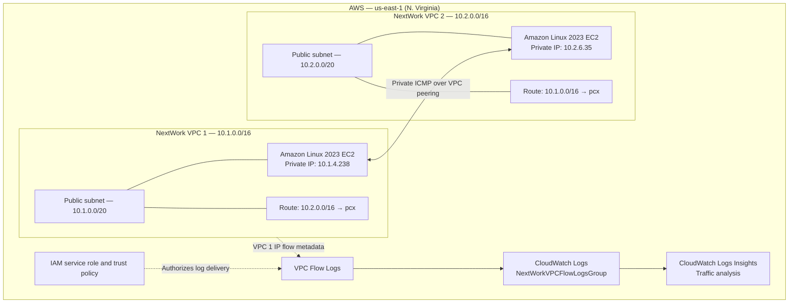

**Network path:** Initially, each VPC had only its own local route and a default route to its internet gateway. Peering plus an explicit destination-CIDR route in **both** route tables enabled private inter-VPC traffic. The flow log shown in the AWS Console was attached to **VPC 1** (which includes its public subnet); this lab does not establish that an equivalent flow log was created on VPC 2.

## AWS environment and configuration

| Component | Configuration implemented |
| --- | --- |
| AWS Region | `us-east-1` (N. Virginia) |
| VPC 1 | `NextWork-1-vpc` — `10.1.0.0/16` |
| VPC 2 | `NextWork-2-vpc` — `10.2.0.0/16` |
| Public subnets | One per VPC; screenshots show `10.1.0.0/20` and `10.2.0.0/20` |
| EC2 instances | Two Amazon Linux 2023 instances; **`t3.micro`** appears in the running-instance evidence |
| Test private IPs | Instance 1: `10.1.4.238`; Instance 2: `10.2.6.35` |
| Security groups | `NextWork-1-SG` and `NextWork-2-SG`; temporary ICMP test access |
| Peering | VPC 1 ↔ VPC 2, with reciprocal route-table entries |
| Flow log | `NextWorkVPCFlowLog`, active on VPC 1; traffic type **All**, 1-minute aggregation |
| CloudWatch log group | `NextWorkVPCFlowLogsGroup` |
| Flow Logs IAM role | `NextWorkVPCFlowLogsRole` |
| Log analysis | CloudWatch Logs event view and Logs Insights QL |

*Public IP addresses and the AWS account identifier have been obscured in the screenshots included with this repository. Private lab CIDRs and private IPs are retained to explain the routing tests.*

## Implementation and evidence

### 1. Build the network

I used the VPC creation workflow to provision **two non-overlapping address spaces**. Each VPC included a public subnet, a route table, and an internet gateway. Keeping the CIDRs separate was essential: overlapping IPv4 CIDR blocks would prevent this VPC peering setup.

<details>
<summary>📸 Two VPCs and the VPC 2 public subnet topology — screenshot</summary>

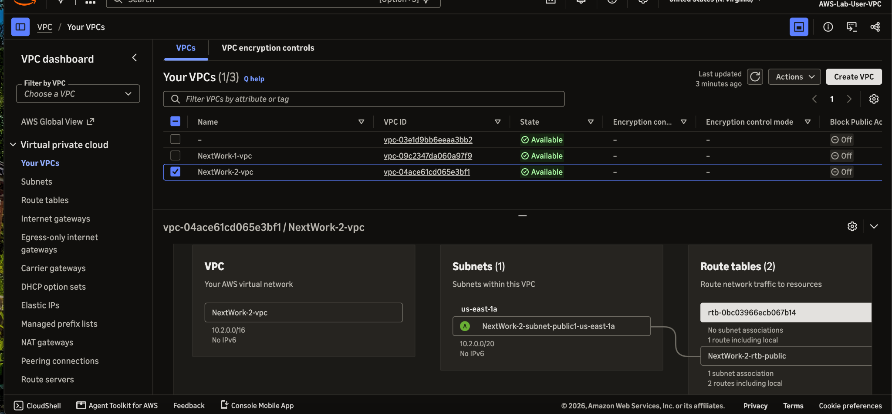

</details>

**Evidence:** The AWS VPC console shows both `NextWork-1-vpc` and `NextWork-2-vpc` available. The selected VPC 2 diagram shows its public subnet associated with its public route table.

**Why it matters:** The VPCs are isolated by default. Creating two address spaces establishes a realistic scenario for testing controlled inter-network routing rather than assuming any two cloud instances can talk directly.

### 2. Launch and secure the EC2 instances

I launched one Amazon Linux 2023 instance in each public subnet to generate measurable network traffic. I used the EC2 console to select the appropriate VPC, subnet, network access, and security group. While the original lab guide mentions `t2.micro`, **my actual running instances were `t3.micro`**, as shown below.

<details>
<summary>📸 EC2 launch-time VPC, subnet and security group configuration — screenshot</summary>

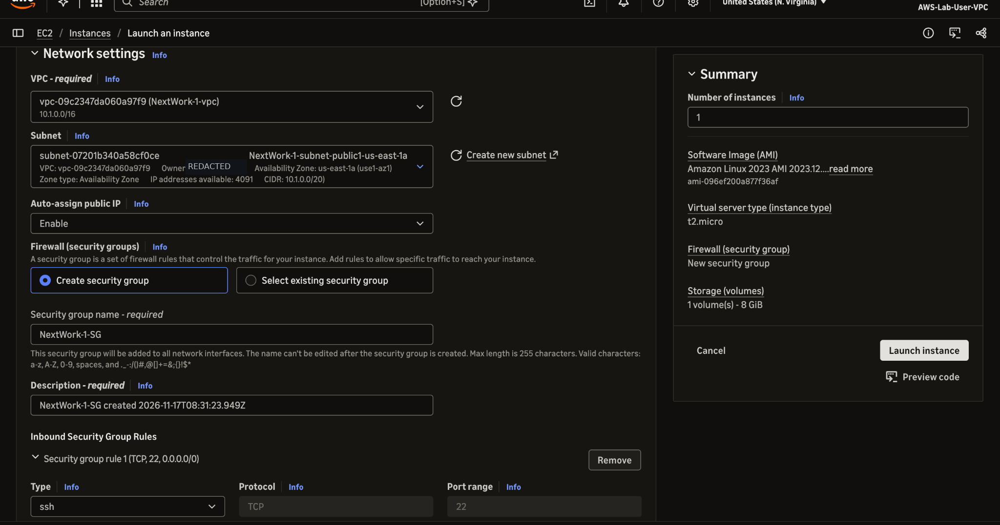

</details>

**Evidence:** Launch configuration for VPC 1, including the public subnet and `NextWork-1-SG`. This is a configuration-stage capture, not the final running-instance state.

<details>
<summary>📸 Both EC2 test instances running and passing status checks — screenshot</summary>

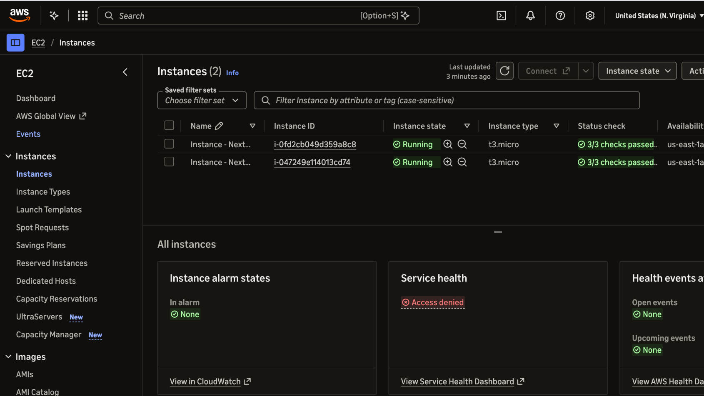

</details>

**Evidence:** Both EC2 instances were running and passed their displayed status checks. These instances served as the endpoints for both public and private ICMP tests.

For the lab's ping tests, the security groups allowed ICMP. SSH (TCP/22) was also enabled for instance access while troubleshooting. **An SSH source of `0.0.0.0/0` is overly permissive and appropriate only as a temporary testing configuration; production access should be restricted or replaced with a safer connection method.**

### 3. Configure logging permissions and delivery

I first created the destination log group, `NextWorkVPCFlowLogsGroup`, so the traffic data would have a central place to be stored and searched.

<details>
<summary>📸 Creation confirmation for the CloudWatch log group — screenshot</summary>

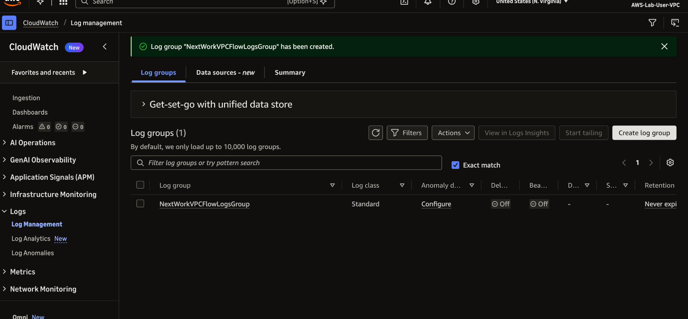

</details>

**Evidence:** CloudWatch shows successful creation of the log group. A log group contains log streams; Flow Logs can write streams associated with monitored network interfaces.

Next, I configured the **IAM service role** used for delivering records. Two policy types were important:

- **Permissions policy:** Allowed the role to create or describe CloudWatch log resources and publish events, including `logs:CreateLogStream` and `logs:PutLogEvents`.
- **Trust policy:** Allowed the AWS service principal `vpc-flow-logs.amazonaws.com` to assume the role with `sts:AssumeRole`.

<details>
<summary>📸 IAM trust policy permitting the VPC Flow Logs service to assume the role — screenshot</summary>

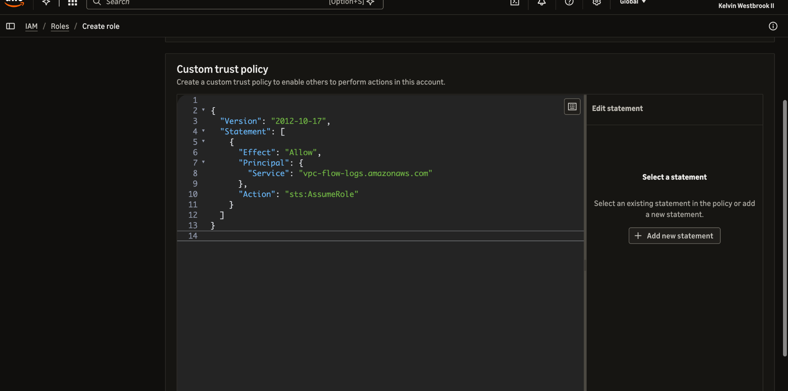

</details>

**Evidence:** The trust policy references the VPC Flow Logs service principal. The trust policy controls *who can assume the role*; the attached permissions policy controls *what that role can do*. My lab permissions policy used `"Resource": "*"`, so a future refinement would scope supported actions more tightly rather than claim the original policy was strictly least-privilege.

I then created `NextWorkVPCFlowLog` on **VPC 1**, sent data to the CloudWatch log group, selected **All** traffic, and used a **1-minute maximum aggregation interval**.

<details>
<summary>📸 Active Flow Log with CloudWatch destination and IAM role — screenshot</summary>

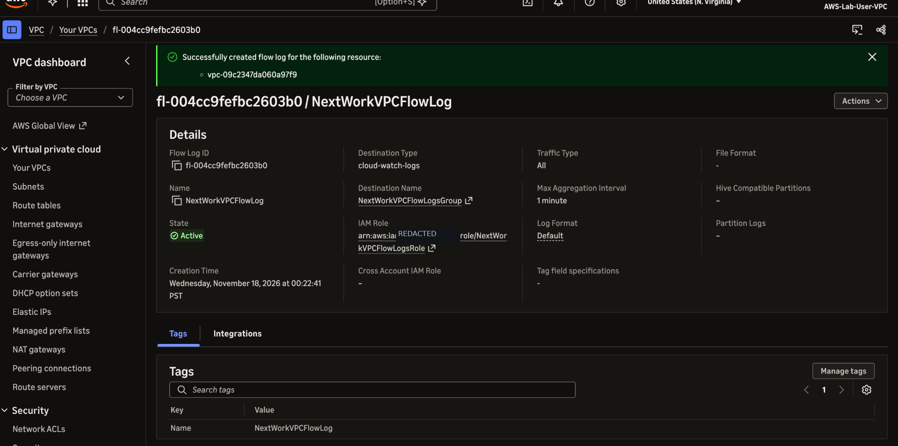

</details>

**Evidence:** The console confirms an **Active** flow log, the CloudWatch destination, the named IAM role, and the configured traffic type and aggregation interval. This proves the monitoring resource was created; the later event screenshots verify log delivery.

### 4. Establish a baseline with connectivity tests

Before peering was configured, I connected to Instance 1 through EC2 Instance Connect and tested Instance 2's private address:

```bash
ping -c 4 10.2.6.35
```

The result was **4 packets transmitted, 0 received — 100% packet loss**.

<details>
<summary>📸 Initial private IP ping test with 100 percent packet loss — screenshot</summary>

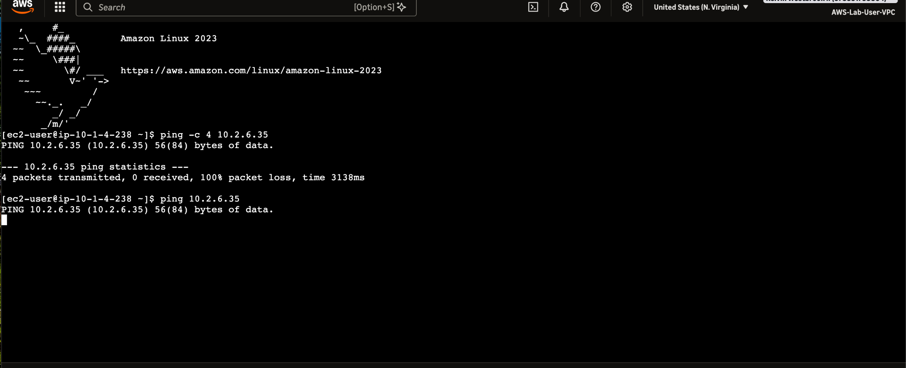

</details>

**Evidence:** The test did not receive private-address replies. It showed an actual connectivity issue to investigate rather than assuming that VPCs were automatically connected.

I then tested communication using **Instance 2's public IPv4 address**. This time, Instance 1 received ICMP replies:

```bash
ping -c 4 <INSTANCE_2_PUBLIC_IPV4>
```

<details>
<summary>📸 ICMP echo replies from Instance 2 public endpoint, public IP redacted — screenshot</summary>

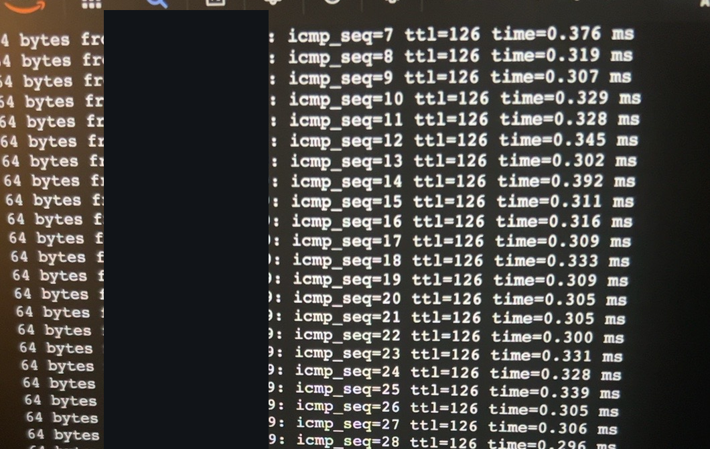

</details>

**Evidence:** ICMP echo replies confirmed reachability via public addressing. **This was not evidence of working private VPC peering**; it established a useful contrast with the failed private-IP test.

### 5. Configure VPC peering and routing

I examined the route tables and found that VPC 1 originally had a `10.1.0.0/16 → local` route and a default route to an internet gateway — **but no route for the other VPC's `10.2.0.0/16` network**. An open Network ACL did not solve the routing gap.

I requested a peering connection between the two VPCs, accepted the request, and configured each subnet-associated route table with the other VPC's network as its destination.

<details>
<summary>📸 VPC peering request between VPC 1 and VPC 2 — screenshot</summary>

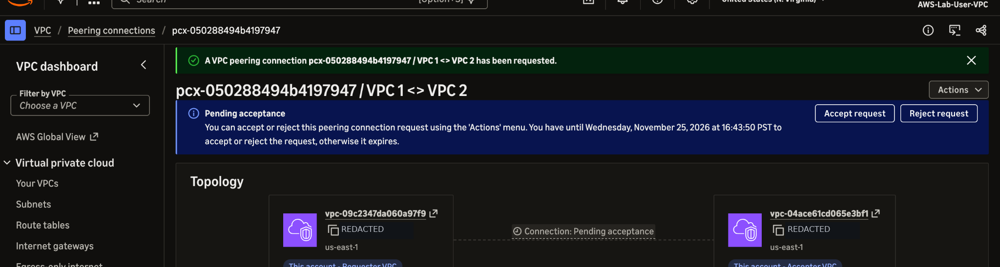

</details>

**Evidence:** The console shows the peering request in **Pending acceptance**. This image documents the request stage; the active peering routes below document later progress.

| Route table | Destination | Target |
| --- | --- | --- |
| VPC 1 public route table | `10.2.0.0/16` | VPC peering connection (`pcx-...`) |
| VPC 2 public route table | `10.1.0.0/16` | The same peering connection (`pcx-...`) |

<details>
<summary>📸 VPC 1 route table showing active route to VPC 2 — screenshot</summary>

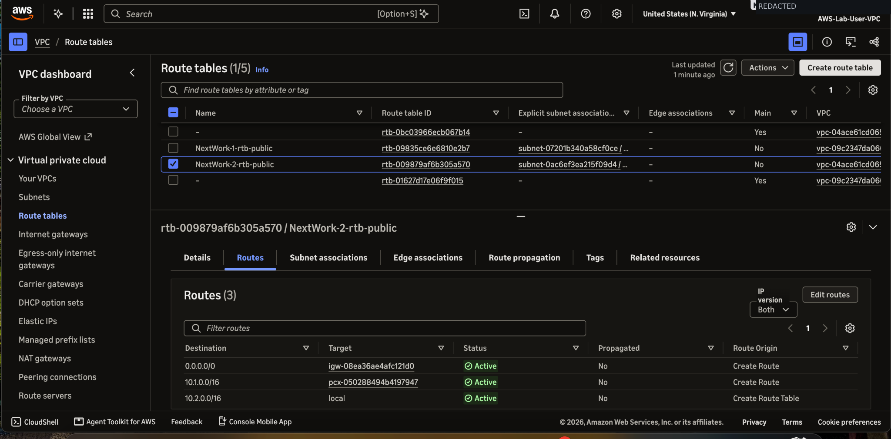

</details>

**Evidence:** VPC 1 has an **Active** route toward `10.2.0.0/16` using the peering connection. Its local and internet gateway routes remain in place.

<details>
<summary>📸 VPC 2 route table showing active return route to VPC 1 — screenshot</summary>

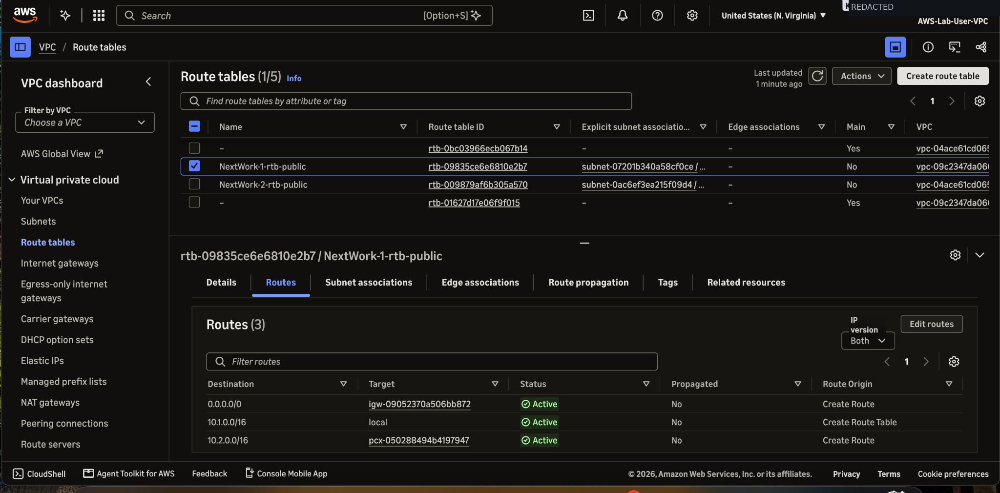

</details>

**Evidence:** VPC 2 has the reciprocal **Active** route toward `10.1.0.0/16`. Return routing is as important as forwarding traffic in the first direction.

After these changes, I repeated the private-IP test and **received replies from Instance 2** (recorded in my project notes). That verified the intended private-network path and distinguished the pre-peering failure from the working peered configuration.

### 6. Investigate recorded network traffic

With VPC Flow Logs enabled, I opened the CloudWatch log group and inspected its log streams. The console showed entries with both **`ACCEPT`** and **`REJECT`** actions.

<details>
<summary>📸 CloudWatch log events with accepted and rejected records — screenshot</summary>

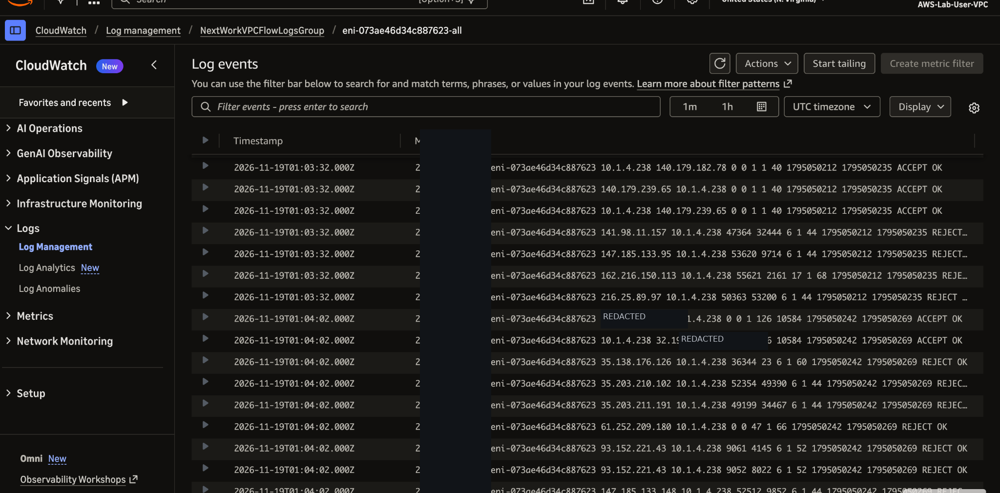

</details>

**Evidence:** The event list includes timestamps, network-interface information, source and destination addresses, protocol, packet and byte counts, and actions. The source and destination values must be interpreted in context: an unfamiliar public IP alone does not prove malicious activity.

<details>
<summary>📸 Expanded CloudWatch log record with REJECT action — screenshot</summary>

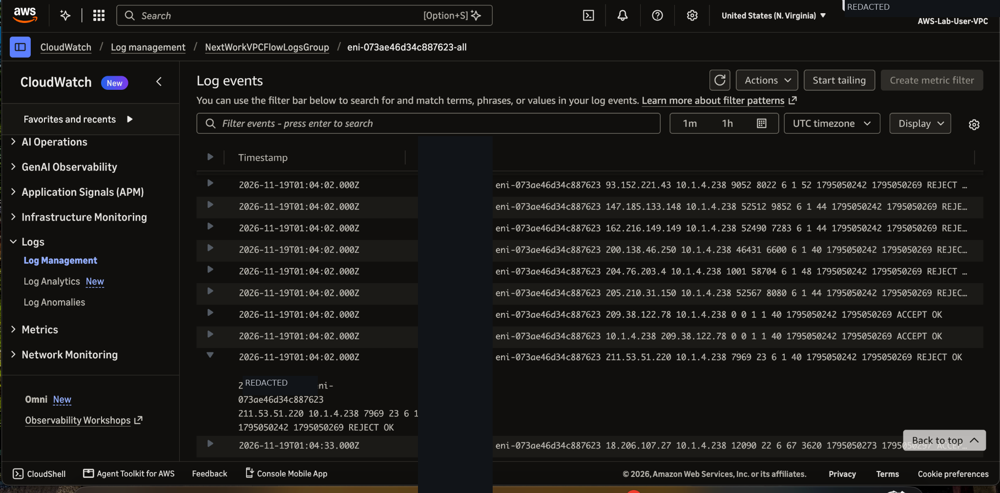

</details>

**Evidence:** An expanded event includes the `REJECT` action and `OK` log status. `REJECT` indicates traffic the security group or Network ACL did not permit; `OK` describes flow-log recording status, not authorization of the connection.

**Default VPC Flow Log fields worth investigating:**

| Field | What I use it for |
| --- | --- |
| `srcaddr`, `dstaddr` | Identify communicating IP addresses |
| `srcport`, `dstport` | Investigate ports for TCP/UDP traffic |
| `protocol` | Differentiate protocols (e.g., `1` is ICMP) |
| `packets`, `bytes` | Estimate the quantity of traffic in the aggregation window |
| `start`, `end` | Associate the event with a test or time period |
| `action` | Distinguish traffic marked `ACCEPT` or `REJECT` |
| `log-status` | Check whether the flow-log record was successfully captured |

Next, I used **CloudWatch Logs Insights** to identify high-volume source/destination address pairs. In the newer CloudWatch layout, this capability may appear under **Log Analytics**; I also used the classic Logs Insights interface for the sample query.

<details>
<summary>📸 CloudWatch Log Analytics interface showing the newer query experience — screenshot</summary>

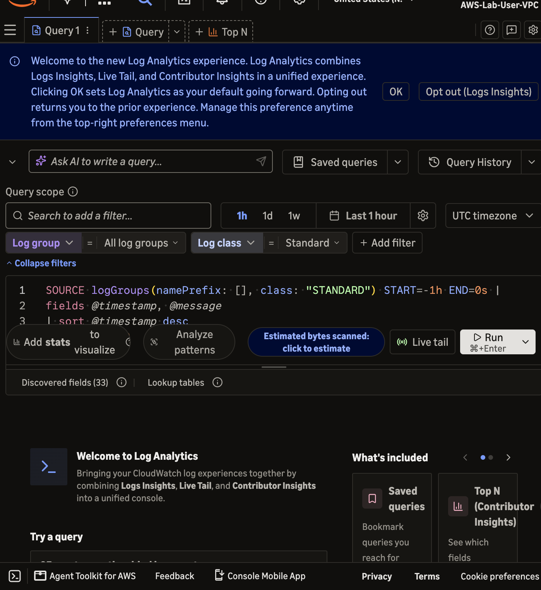

</details>

**Evidence:** CloudWatch introduced a revised query interface during this lab, so I learned how to locate the same analysis workflow despite UI differences from the tutorial.

My Logs Insights QL query was:

```sql
stats sum(bytes) as bytesTransferred by srcAddr, dstAddr
| sort bytesTransferred desc
| limit 10
```

It **groups log records by source and destination address**, sums the `bytes` field for each pair, sorts the results in descending order, and returns the ten largest totals for the selected time window. These are aggregated **recorded network bytes**, not a packet capture or proof of file exfiltration.

<details>
<summary>📸 Top 10 source and destination address pairs by bytes transferred — screenshot</summary>

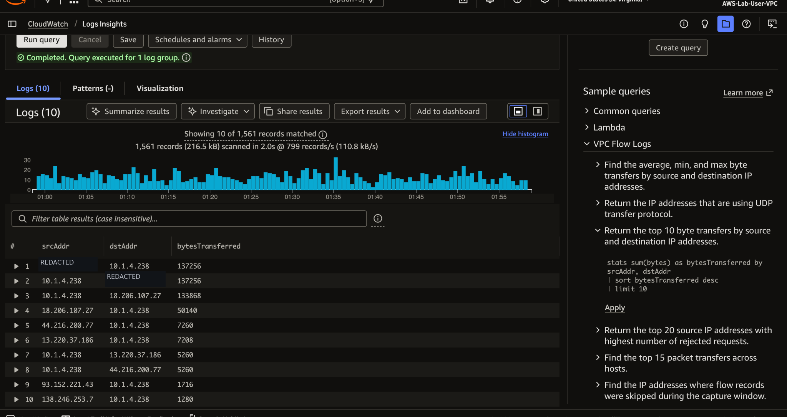

</details>

**Evidence:** The query completed against one log group, showing **1,561 matching records** scanned in the displayed interval and a ranked table. The top address pair in the screenshot had **137,256 recorded bytes** in each direction of the displayed source/destination pairing. The public instance IP in that table has been redacted.

---

## Findings and security analysis

| Observation | Interpretation |
| --- | --- |
| Private ping initially lost all 4 packets | The required inter-VPC route/peering path had not been established |
| Public-IP ping returned replies | Public addressing and ICMP access were sufficient for that test; private routing was still separate |
| Reciprocal peering routes showed **Active** | Each VPC had a route for the other VPC's CIDR through the peering connection |
| Private-address ping later succeeded | The final configuration enabled the intended private connection between test instances |
| Flow Log was **Active** and records appeared in CloudWatch | Log delivery was functioning for monitored VPC 1 network interfaces |
| CloudWatch records included `ACCEPT` and `REJECT` | AWS network controls were allowing some flows and rejecting others; this alone does not determine intent |
| Top-10 query grouped and summed byte counts | Flow Logs can support traffic-volume triage and prioritization of further investigation |

**Analyst takeaway:** VPC Flow Logs are especially useful for **visibility, connectivity troubleshooting, and investigation**. They record IP flow metadata rather than the full packet payload, and their aggregation/delivery behavior means they should not be described as a real-time intrusion-prevention system.

## Troubleshooting and lessons learned

This lab included several problems that taught me how network configuration and IAM authorization interact:

| Challenge | What I investigated or changed | Lesson |
| --- | --- | --- |
| AMI information failed to load | An IAM error identified missing `ec2:DescribeImages`; I reviewed EC2 permissions rather than rebuilding the VPC | A console error can be a permissions issue, not a missing resource |
| CloudWatch log-group creation was denied | I reviewed `logs:CreateLogGroup` access and then confirmed the group was successfully created | Log storage and log delivery are separate authorization concerns |
| IAM role or policy lists were inaccessible | I inspected missing `iam:ListRoles` / `iam:ListPolicies` permissions and used authorized account management to check setup | Read access to IAM metadata is not automatically granted |
| Flow Logs could not yet deliver records | I created the missing IAM role and gave it an appropriate trust relationship and CloudWatch delivery policy | A service role needs both a trust policy and a permissions policy |
| EC2 Instance Connect initially failed | I investigated `SendSSHPublicKey`, SSH rules, public-IP reachability, subnet routing, instance health, and Network ACLs | Troubleshoot identity and network layers separately; the single definitive cause of the eventual connection recovery was not established |
| Private-IP ping timed out before peering | I compared successful public-IP traffic with missing private routes, then added bidirectional peering routes | A security rule that allows traffic cannot replace a missing route |
| AWS console layout differed from the guide | I located Logs Insights functionality through the revised Log Analytics UI and classic view | Documentation and console labels change; understand the underlying service task |

My biggest learning was **not to interpret every connection failure as a firewall problem**. Effective AWS troubleshooting means validating identity permissions, subnet routing, security groups, Network ACLs, service roles, and the evidence in logs.

## Security considerations and improvements

This was a deliberately open **short-lived test lab**. Before adapting this design to a real environment, I would:

1. **Restrict inbound rules.** Replace public SSH `0.0.0.0/0` exposure with an appropriately constrained source or a private management mechanism. Narrow ICMP access to test CIDRs or remove it when no longer needed.
2. **Tighten IAM policy scope.** Replace permissive wildcard resource access where supported; keep `iam:PassRole` limited to the specific Flow Logs delivery role and service principal.
3. **Set log retention and budget safeguards.** The initial CloudWatch log group showed no expiration. Apply an appropriate retention policy and monitor log-ingestion charges.
4. **Expand monitoring deliberately.** Add a VPC 2 flow log if visibility into both networks is required; compare records from each side when investigating cross-VPC traffic.
5. **Add detections instead of only ad hoc queries.** Build repeatable queries for rejection spikes, unusual byte volumes, and unexpected destination patterns, with thresholds backed by a baseline.
6. **Clean up unused resources.** After preserving evidence, terminate lab EC2 instances, remove peering and related routes, delete unnecessary flow logs and CloudWatch log groups, and confirm no billable resources remain. **Cleanup is a recommendation here, not a claim that it has been completed.**

## Skills demonstrated

- **AWS networking:** VPCs, public subnets, CIDR planning, internet gateways, route tables, and VPC peering.
- **IAM security:** Permissions policies, role trust relationships, service principals, policy troubleshooting, and controlled role passing.
- **Security monitoring:** VPC Flow Logs, CloudWatch log groups and streams, `ACCEPT`/`REJECT` interpretation, and network metadata analysis.
- **Log analytics:** CloudWatch Logs Insights QL aggregations, grouping, sorting, and traffic-volume analysis.
- **Technical troubleshooting:** EC2 Instance Connect, IAM access denials, ICMP testing, routing diagnosis, and evidence-based validation.
- **Documentation:** Architecture mapping, configuration evidence, before/after testing, and transparent reporting of lab limitations.

## References and attribution

This project was completed using the **[NextWork VPC Monitoring with Flow Logs](https://nextwork.ai/projects/6954a600-a89e-56b0-886b-7054da118a3b)** learning lab as guidance. This README is my own portfolio write-up based on my AWS screenshots, results, troubleshooting, and reflections rather than a reproduction of the provided NextWork README.

Additional AWS technical references:

- [AWS — VPC Flow Logs](https://docs.aws.amazon.com/vpc/latest/userguide/flow-logs.html)
- [AWS — Flow log record fields](https://docs.aws.amazon.com/vpc/latest/userguide/flow-log-records.html)
- [AWS — IAM role for publishing Flow Logs to CloudWatch](https://docs.aws.amazon.com/vpc/latest/userguide/flow-logs-iam-role.html)
- [AWS — VPC peering routing](https://docs.aws.amazon.com/vpc/latest/peering/vpc-peering-routing.html)
- [AWS — CloudWatch Logs Insights query syntax](https://docs.aws.amazon.com/AmazonCloudWatch/latest/logs/CWL_QuerySyntax.html)

---

*Lab environment: AWS `us-east-1` · Completed November 2026 · Screenshots captured from my AWS Console with selected account and public-IP details obscured for publication.*